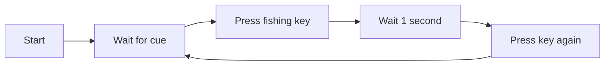

# wow-fishing

A small **hobby / learning project** (Windows only) that listens to the game's audio output for a
fishing-splash cue, then presses the fishing key, waits one second, and presses it again.



> **Heads up:** automating input in an online game may violate that game's Terms of Service and
> can get an account actioned. This repository exists to learn about audio capture, signal
> processing, and testable design. Use it at your own risk, and not somewhere it is prohibited.

## Design

- Audio detector and keypress wrapper sit behind interfaces (`Detector`, `AudioSource`,
  `KeyPresser`), so everything is testable on Linux/macOS with fakes.
- Windows-only libraries (`pydirectinput`, `PyAudioWPatch`, `keyboard`) are imported lazily, only
  when the real implementation is constructed.
- Detection is RMS plus band-energy spike detection against a running baseline.
- A visual detector (`mss` + OpenCV template match) is a stub for a later version.

```
src/wow_fishing/
  __main__.py          CLI entry (python -m wow_fishing)
  config.py            config.toml loading
  controls.py          pause/quit state and global hotkeys
  input.py             KeyPresser interface, pydirectinput + dry-run implementations
  loop.py              cue -> press -> wait -> press loop
  fakes.py             fake detector / key presser / audio source (tests and demos)
  detectors/
    base.py            Detector interface
    audio.py           spike analyzer, AudioDetector, WASAPI loopback source
    visual.py          stub
tools/record_sample.py record game audio and replay it through the detector offline
tests/                 pytest suite (runs anywhere)
```

## Setup

Windows, Python 3.11+:

```powershell
python -m venv .venv
.venv\Scripts\activate
pip install -e ".[windows,dev]"
copy config.example.toml config.toml
```

On Linux/macOS you can install just the dev tools and run the tests and the demo mode:

```bash
pip install -e ".[dev]"
```

## Run

```powershell
python -m wow_fishing -c config.toml            # real: audio detector + pydirectinput
python -m wow_fishing --dry-run                 # log key presses instead of sending them
python -m wow_fishing --detector fake --dry-run --no-hotkeys --max-cycles 3   # works anywhere
```

Hotkeys (configurable): **F9** pause/resume, **F10** quit. `Ctrl+C` also stops it. Set the fishing
key in `config.toml` under `[input]`, and make sure the game window has focus when it fires.

## Tuning the audio threshold

1. In game, record some audio that includes a few splashes:

   ```powershell
   python tools/record_sample.py --seconds 30 --out samples/splash.wav -c config.toml
   ```

   It prints the times where the detector would have fired.
2. Replay as often as you like without the game:

   ```powershell
   python tools/record_sample.py --analyze samples/splash.wav -c config.toml
   ```

3. Adjust `[audio]` in `config.toml`:
   - `band_low_hz` / `band_high_hz`: frequency range where the splash is strongest.
   - `spike_ratio`: how many times louder than the baseline (in that band) counts as a cue.
     Lower it if cues are missed, raise it for false positives.
   - `min_rms`: absolute loudness floor so quiet noise never triggers.
   - `cooldown`: seconds to ignore spikes after a cue (and after each press).
4. Keep game music and ambient volume steady while tuning; the baseline adapts slowly.

## Development

```bash
pip install -e ".[dev]"
pytest
ruff check .
ruff format --check .
```

There is no CI; run these locally before committing.
